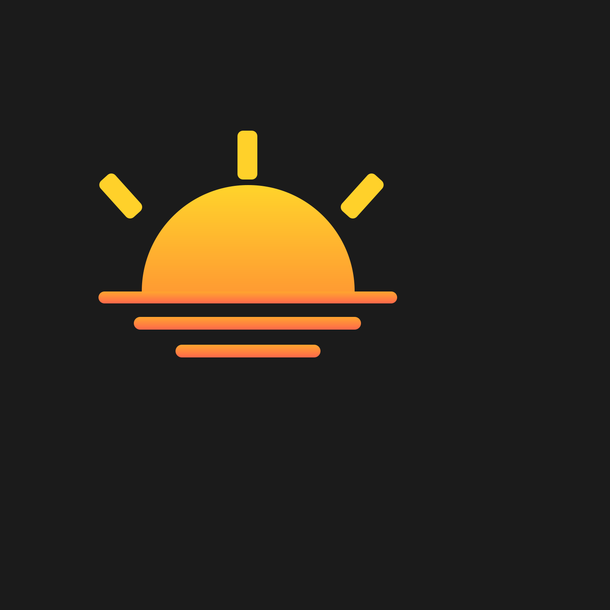

# Sunrise

  

A modular floating mod menu for Geometry Dash.

Sunrise brings gameplay tools, player options, visual controls, quality-of-life features, and performance settings together in one configurable in-game interface.

## Project structure

- `src/core` — feature registration and shared systems
- `src/ui` — floating button and menu interface
- `src/features` — gameplay, player, visuals, performance, and QoL modules
- `.github/workflows` — automated Android64 builds

## Build

Sunrise uses the Geode SDK and CMake. The Android64 package is built through GitHub Actions. The workflow renders the vector logo into the `logo.png` asset that Geode displays in its mod interface.

## Development

Features are designed to be opt-in, independently configurable, and isolated so a problem in one module does not disable the entire menu.
